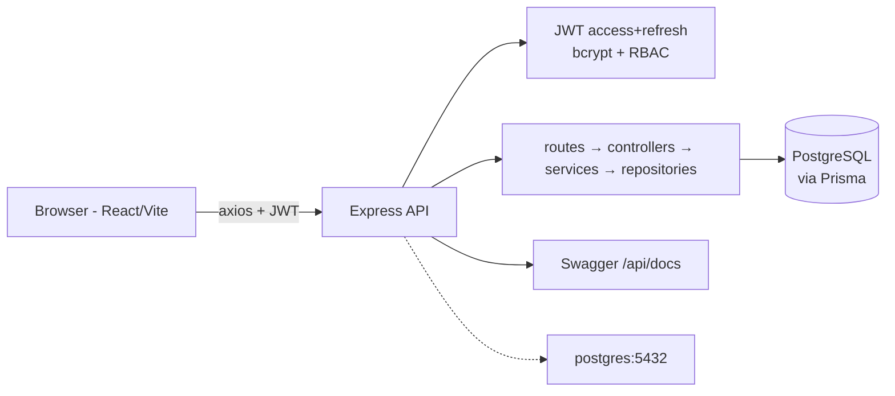

# TaskFlow

Production-style project management app: React + Express + Prisma + PostgreSQL with JWT auth, RBAC, Kanban + list views, and dashboard.

## Architecture



- **Frontend (`web/`)**: React 18 + TS + Vite, Redux Toolkit, React Router, Tailwind. Feature folders: `auth`, `projects`, `tasks` (kanban/list), `dashboard`. Typed axios client with access-token attach + single-flight refresh interceptor.
- **Backend (`api/`)**: Express + TS, layered `routes → controllers → services → repositories (Prisma)`. Zod on every body, central error handler with `{ error: { code, message, details } }`, pagination, helmet, CORS, rate-limit on auth.
- **DB**: Prisma schema with `User / Project / ProjectMember / Task / RefreshToken`, FK indexes, seed script.

## Quickstart (one command)

Prereqs: Docker Desktop running, Node 20+.

```bash
cp .env.example .env
docker compose up --build
```

- Web: http://localhost:5173
- API: http://localhost:4000/api/health
- Docs: http://localhost:4000/api/docs
- Seed login: `admin@taskflow.local / Admin123!`, `member@taskflow.local / Member123!`

## Local dev (without Docker)

```bash
# Postgres must be running; set DATABASE_URL in api/.env
cd api && npm install
npx prisma migrate dev
npm run db:seed
npm run dev   # :4000

cd ../web && npm install
echo "VITE_API_URL=http://localhost:4000/api" > .env
npm run dev   # :5173
```

## API overview

| Method | Path | Auth | Notes |
|---|---|---|---|
| POST | `/api/auth/register` | public, rate-limited | First user becomes ADMIN (bootstrap default) |
| POST | `/api/auth/login` | public, rate-limited | returns access+refresh |
| POST | `/api/auth/refresh` | refresh token | rotates refresh token |
| POST | `/api/auth/logout` | — | revokes refresh |
| GET | `/api/auth/me` | Bearer | current user |
| GET/POST | `/api/projects?page&limit&search` | Bearer | ADMIN: all; MEMBER: owned/member only |
| GET/PUT/DELETE | `/api/projects/:id` | Bearer | update/delete: owner or ADMIN |
| POST/DELETE | `/api/projects/:id/members[/:userId]` | owner/ADMIN | body `{ email }` or `{ userId }` |
| GET/POST | `/api/projects/:projectId/tasks?...` | member | filter `status,priority,assigneeId,search,overdue`, sort `sort,order`, paginated |
| GET/PUT/DELETE | `/api/tasks/:id` | member | `PUT {status}` drives Kanban DnD |
| GET | `/api/dashboard/summary` | Bearer | `{ totalProjects, totalTasks, byStatus, overdue }` |
| GET | `/api/users` | ADMIN | user list, paginated |

Error shape: `{ "error": { "code": "VALIDATION_ERROR|UNAUTHORIZED|...", "message": "...", "details": ... } }`.

## Tests

```bash
cd api && npm test        # unit (always) + integration (needs DATABASE_URL)
cd ../web && npm test     # Vitest + RTL
```

Backend unit covers pagination, Zod, JWT, bcrypt. Integration (Supertest) covers register→login→me→refresh→logout and project/task CRUD + RBAC; it skips gracefully without DB and runs fully in CI (postgres service).

## Screenshots

> Add screenshots here after `docker compose up`:
- `docs/screenshot-dashboard.png` — Dashboard with counts + overdue
- `docs/screenshot-kanban.png` — Kanban drag-and-drop
- `docs/screenshot-list.png` — List with filter/sort

## Decisions / defaults (ambiguous points)

- First registered user becomes `ADMIN` (bootstrap); subsequent public registrations are `MEMBER`. Documented in `authService`.
- Project creator auto-joins as member; owner cannot be removed from members.
- Task `position` auto-appends per status column; changing status without explicit position moves to end.
- Refresh tokens stored hashed (sha256) with rotation + revocation; also set as HttpOnly cookie for browser flows while returning JSON tokens for the SPA.
- No Docker daemon locally: unit + frontend tests and both production builds verified; Postgres integration runs in CI.
